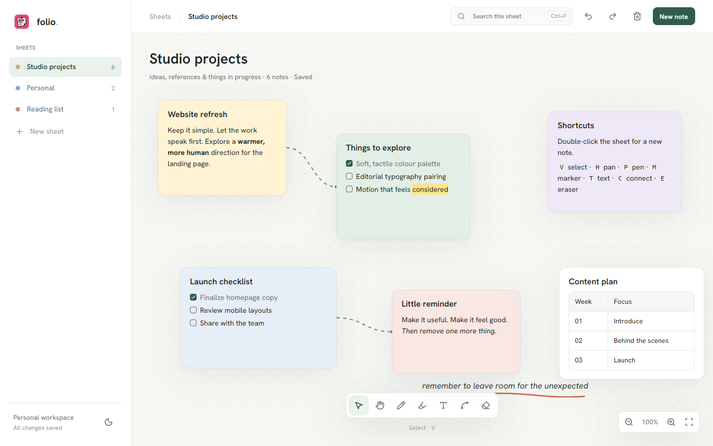

<p align="center"></p>

# Folio

Sticky notes on endless sheets: one sheet per category, like worksheets in a
workbook. Drag notes around, write Markdown (tables, task lists, coloured
highlights), pin pictures and animated GIFs, draw on the sheet, write on it,
and link notes with curved connectors. Written in Rust on
[GPUI](https://www.gpui.rs/) (through `gpui-kit`) for a GPU-drawn,
low-latency canvas.



## Run it

```sh
cargo run --release
```

On Linux, GPUI needs `libxkbcommon-dev libxkbcommon-x11-dev libwayland-dev
libvulkan-dev libfontconfig1-dev libx11-xcb-dev`, plus a Vulkan driver.

Your workspace is saved in `%APPDATA%\Folio` (Windows),
`~/Library/Application Support/Folio` (macOS) or `~/.local/share/folio`
(Linux). Set `FOLIO_DATA_DIR` to use another folder. It holds `board.json`
and a `media/` folder for pictures.

## Use it

- **Double-click** the sheet for a new note; double-click a note to edit it.
- **Drag** a note to move it, drag its corner to resize, drag the empty
  sheet to pan, **Ctrl+wheel** to zoom.
- **Tools** (dock at the bottom): `V` select, `H` pan, `P` pen, `M` marker,
  `T` text on the sheet, `C` connect two notes, `E` eraser.
- **Drop** pictures or `.md`/`.txt` files on a sheet, or **paste** them.
- `Ctrl+Z` / `Ctrl+Shift+Z` undo and redo, `Ctrl+F` search, `Ctrl+0` zoom to
  fit, `Ctrl+Shift+L` dark mode, `Ctrl+Tab` next sheet.

See [docs/PLAN.md](docs/PLAN.md) for the product and architecture plan and
the roadmap.

## Windows build

Cross-compiled from Linux with MinGW, as forge-gpui's installer does:

```sh
rustup target add x86_64-pc-windows-gnu   # plus gcc-mingw-w64-x86-64
cargo build --release --target x86_64-pc-windows-gnu
# → target/x86_64-pc-windows-gnu/release/folio.exe
```

The patched GPUI Windows renderer in `vendor/gpui-pre-windows` compiles its
shaders when the app starts, so an .exe built without the Windows SDK still
draws. The icon (`assets/folio.ico`) is embedded by `build.rs`. A native
build (`cargo build --release` on Windows with MSVC) should work too; it
hasn't been tried yet.

## Develop

```sh
cargo test                  # model, storage and Markdown-tint tests
scripts/screenshots.sh out  # light/dark screenshots on a virtual display (Linux)
scripts/icons.sh            # logo SVGs → PNGs and the Windows .ico
```

Dependencies are pinned to exact versions. Icons are Lucide (ISC); the fonts
are Hanken Grotesk and JetBrains Mono (OFL).
