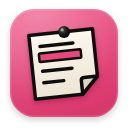
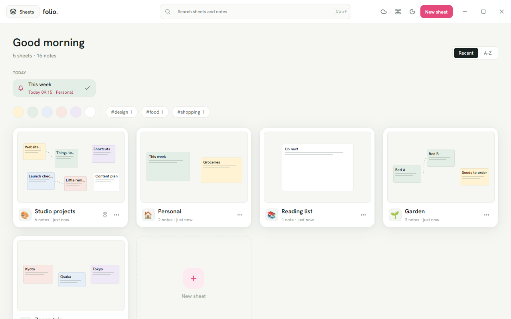
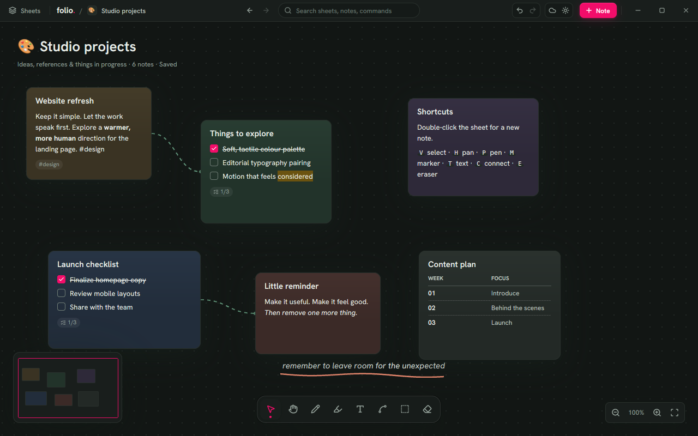
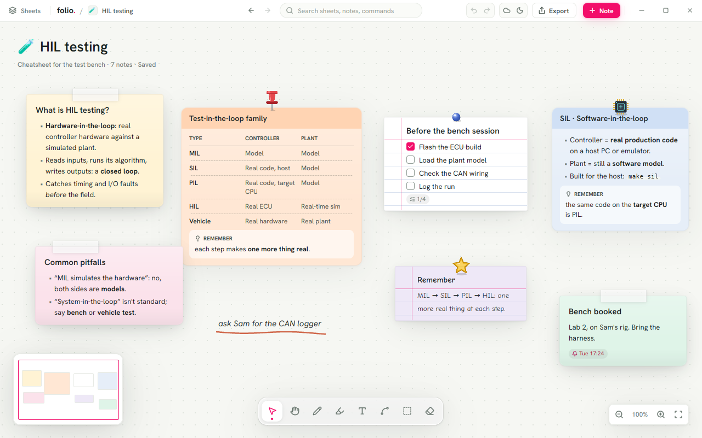

<p align="center"></p>

# Folio

Sticky notes on endless sheets: one sheet per category, like worksheets in a
workbook. Written in Rust on [GPUI](https://www.gpui.rs/) (through
`gpui-kit`) for a GPU-drawn, low-latency canvas.



- **Home:** every sheet as a card with a live miniature, today's reminders,
  your #tags, and search across every note. The sheets drawer stays hidden
  until you want it (top-left button or Ctrl+B).
- **Notes:** type straight onto them; Markdown with tables, task lists you
  tick with a click, coloured highlights, pictures and animated GIFs, link
  cards; notes grow with their text; reminders; lock; a handwritten font.
  Four types of note: card, taped, cheat card (the title on a band) and
  index card (ruled, with a pin); a pin for any note, in 18 shapes (classic
  push pins, tech, cute, stars, fun), three sizes and eight colours;
  Remember boxes from `>` lines; a **Tasks** page (drawer or Ctrl+K)
  with every task on every sheet, ticked right there; `[[links]]` to
  notes and sheets anywhere, with the notes that link back; an edit
  bar with bold, italic, lists, tasks, tables and more, each with a
  shortcut; pasted plain text turned into Markdown in one go.
- **The sheet:** pan and zoom, box-select and move groups with alignment
  guides, areas (Kanban columns, days of the week…), pen, marker, eraser,
  text on the sheet (Markdown that wraps, in any ink, typeface and size,
  with its own bar of marks while you write), curved links between
  notes, tidy up, a map.
  Each sheet picks its background: dots, grid, graph paper, lines,
  crosses, isometric or plain, on one of six paper colours, or a picture
  or SVG of your own behind it.
- **Everywhere:** Ctrl+K for commands, sheets and notes; Ctrl+Alt+N (or keys
  of your own, set in Settings) from any app for a quick note into your Inbox or any sheet; notes pinned to the desktop
  above other windows; a tray icon and starting with Windows.
- **Safe:** undo, a Trash that keeps things 30 days, an Archive, and a
  backup every day (the last 14 kept) you can restore from.





## Run it

```sh
cargo run --release
```

On Linux, GPUI needs `libxkbcommon-dev libxkbcommon-x11-dev libwayland-dev
libvulkan-dev libfontconfig1-dev libx11-xcb-dev`, plus a Vulkan driver.

Your workspace is saved in `%APPDATA%\Folio` (Windows),
`~/Library/Application Support/Folio` (macOS) or `~/.local/share/folio`
(Linux). Set `FOLIO_DATA_DIR` to use another folder. It holds `board.json`,
a `media/` folder for pictures, and `view.json`: where each sheet is
scrolled to on this computer, kept apart so panning never rewrites (or
syncs) the notes.

A first launch opens on one empty sheet, *My notes*. Older versions started
with sample sheets; the ones left untouched are removed on update, edited
ones stay. `FOLIO_DEMO=1` with a new data folder opens on the samples
(for screenshots and demos).

**Font.** Folio draws its interface in **Anthropic Sans** when it has it:
built into the .exe from `assets/fonts/extra/` (git-ignored; only fonts
you're licensed to redistribute, see the README there), installed in the
system, or as `.ttf`/`.otf` files in a `fonts` folder inside the data
folder. Otherwise it uses Hanken Grotesk.

**Search** is the field in the title bar, which is also the command palette
(Ctrl+K; Ctrl+F opens it on notes). Results drop below it under tabs with
counts: All, Commands (`>`), Sheets (`/`) and Notes (`@`, where `#tag` and
`paper:sage` work). Matching is fuzzy with the matched letters marked,
Tab changes scope, recently used things come first, and with nothing found
Enter makes a note (or a sheet) of what you typed.

**Renaming** a sheet: click its title on the sheet, type, Enter.

**Tools** go back to Select when you click the one in use again (or press
Esc). Settings, Trash and Sync & export close the same way, or with Esc.

**Notes** resize from any edge or corner: hover a selected note's border
and the pointer shows which way it will go.

The window has no system title bar: Folio's top bar is the title bar.
Drag it to move the window (on Windows, with snapping), double-click it
to maximize, and use the minimize / maximize / close buttons at its right
end.

### Sync & export

The cloud button in the top bar (or the drawer, or Ctrl+K › *Sync &
export*) opens one screen for getting sheets in and out.

**Google Drive (optional).** *Sign in with Google* opens Google's sign-in
in your browser. After that, Folio keeps `board.json` and `media/` in a
**Folio** folder in your Drive: it syncs a few seconds after each change,
once a minute, at start-up and on quit. The cloud button's dot says where
it's at: green synced, pink syncing, red a problem.

- **Merging.** Work on two computers and both sets of changes are kept:
  each sheet, note, drawing, text, connector and area is merged on its own
  from the last version both shared (`sync-base.json`). A note edited in
  both places keeps its newest edit; something deleted on one side but
  edited on the other is kept. Two computers that give new things the
  same number are told apart, and pictures get unique names.
- **The first sync** on a computer that already has notes asks: *Merge
  both* (recommended), *Keep this computer's* or *Use Google Drive's*.
  Whichever side is replaced goes to Backups first.
- **Start over**: *Send everything from here* makes Drive an exact copy of
  this computer (Drive keeps earlier versions of board.json for 30 days);
  *Bring everything from Drive* does the reverse, after a backup.

Folio asks only for `drive.file`, so it sees just the files it made. The
sign-in is kept in `google.json` in the data folder, never in the board.
Theme, start-up, shortcut, where each sheet is scrolled to and notes on the
desktop stay per computer.

**Export.** Choose sheets (or *Export…* on a sheet card's menu) and a
format: **Markdown**, a folder with one `.md` per sheet and its pictures,
for any notes app; or a **Folio file** (`.folio`), the sheets exactly with
pictures inside. **Import** a `.folio` file (or drop it on a sheet) and its
sheets are added beside yours.

Sign-in needs the app's own OAuth client, set when the .exe is built:

1. In [Google Cloud console](https://console.cloud.google.com/), make a
   project and enable the **Google Drive API**.
2. *Google Auth Platform › Branding*: an app name (Folio) and your email.
   *Audience*: External; while it's in Testing, add the Google accounts
   that may sign in as test users. *Data access*: add the
   `.../auth/drive.file` scope.
3. *Clients › Create client*: type **Desktop app**. Copy its ID and secret.
4. Build with them:

   ```sh
   FOLIO_GOOGLE_CLIENT_ID=….apps.googleusercontent.com \
   FOLIO_GOOGLE_CLIENT_SECRET=GOCSPX-… \
   cargo build --release --target x86_64-pc-windows-gnu
   ```

   The same two variables also work at run time. Google doesn't treat a
   desktop app's secret as secret; PKCE protects each sign-in.

Without a client the button says sign-in isn't set up in this build, and
everything else works as before. To try the whole flow without an account,
a debug build talks to a local fake of Google when `FOLIO_GOOGLE_FAKE` is
set to its address.

## Use it

| | |
|---|---|
| Double-click the sheet | A new note, ready to type into |
| Double-click a note, or Enter | Type into it; Esc or Done to finish |
| Right-click | A note's, the sheet's, an area's or a card's menu |
| Drag a note's edge or corner | Resize it from that side |
| Drag the empty sheet | Select a group; Space+drag, middle-drag or the wheel pans |
| Ctrl+click or Shift+click | Add a note to the selection, or take it out (Ctrl or Shift and a drag adds a box); the bar above the tools then locks, duplicates, moves, archives or trashes them all, and a selected note's right-click menu acts on all of them |
| Ctrl+wheel | Zoom |
| `V H P M T C F E` | Select, pan, pen, marker, text, connect, area, eraser |
| Arrows | Move between notes |
| Ctrl+C / Ctrl+X / Ctrl+V | Copy, cut and paste notes (whole: paper, type, pin, the links between them; other apps get their text). Cut notes wait in the Trash until pasted |
| Click a selected note's words | Select text in it; Ctrl+C copies the words. The note still drags by its title or edges |
| Click a link in a note | Open it; a pasted link card has an ↗ button that opens its page |
| Ctrl+K | Search: commands, sheets and notes |
| Ctrl+F | Search notes |
| Ctrl+Alt+N | Quick note from any app; Settings › Quick note shortcut takes other keys (click them, press new ones) |
| Ctrl+N / Ctrl+Shift+N | New note / new sheet |
| Ctrl+B | The sheets drawer (bold, while typing in a note) |
| While typing | Ctrl+B / I bold, italic · Ctrl+E code · Ctrl+Shift+X strikethrough · Ctrl+Shift+M highlight · Ctrl+Shift+B / O / C bullets, numbers, tasks · Ctrl+Shift+R a Remember box · Enter continues a list |
| S | The selected notes' type: card, taped, cheat card, index card |
| Ctrl+Shift+T | Turn text into Markdown (the selection, or the whole note) |
| Ctrl+Shift+V | Paste as Markdown |
| Ctrl+Z / Ctrl+Shift+Z | Undo / redo |
| Ctrl+, | Settings |

Drop pictures or `.md`/`.txt` files on a sheet, or paste them; paste a web
address for a link card.

See [docs/PLAN.md](docs/PLAN.md) for the product and architecture plan and
the roadmap.

## Windows build

Cross-compiled from Linux with MinGW, as forge-gpui's installer does:

```sh
rustup target add x86_64-pc-windows-gnu   # plus gcc-mingw-w64-x86-64
cargo build --release --target x86_64-pc-windows-gnu
# → target/x86_64-pc-windows-gnu/release/folio.exe
```

The patched GPUI Windows renderer in `vendor/gpui-pre-windows` compiles its
shaders when the app starts, so an .exe built without the Windows SDK still
draws. The icon (`assets/folio.ico`) is embedded by `build.rs`. A native
build (`cargo build --release` on Windows with MSVC) should work too; it
hasn't been tried yet.

## Develop

```sh
cargo test                  # model, storage and Markdown-tint tests
scripts/screenshots.sh out  # light/dark screenshots on a virtual display (Linux)
scripts/icons.sh            # logo SVGs → PNGs and the Windows .ico
```

Dependencies are pinned to exact versions. Icons are Lucide (ISC); the fonts
are Hanken Grotesk, JetBrains Mono and Comic Neue (OFL).
